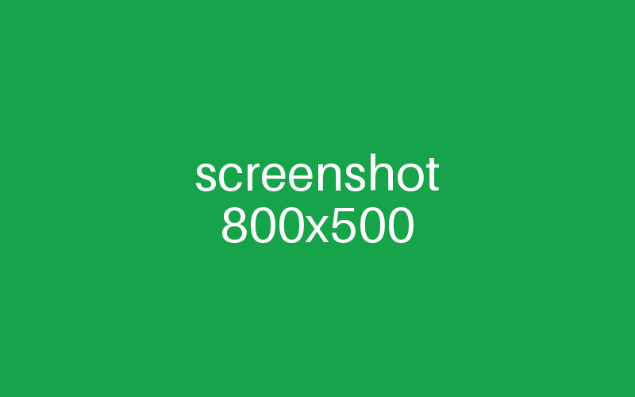

# Echo Chat

A chat model that echoes your message, or tells a joke with /joke.

> A test plugin for the [dashAI](https://github.com/DashAISoftware/DashAI) plugin store.

## Components

| Class | Type |
| --- | --- |
| `EchoChatTask` | GenerativeTask |
| `EchoModel` | GenerativeModel |

## Usage

In **Generative**, choose the **Echo chat (plugin)** task and the **Echo (plugin)** model. Write anything, or `/joke`.

## Screenshots

A tall image beside a small icon:

 

## Details

- **Requires:** dashAI 0.10.0 or newer.
- **Dependencies:** `pyjokes>=0.6`.
- **Releases:** Releases are built and signed by this repo's GitHub Actions workflow (`.github/workflows/release.yaml`): dashAI shows them as verified.

## License

MIT
